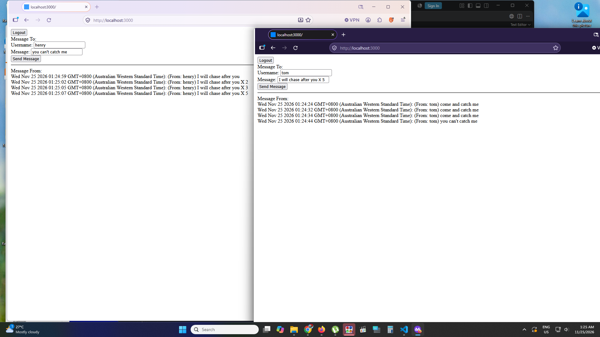

# eventSourceTrial
# Short Description
A simple trial created for the JavaScript Object EventSource.

# Prerequisite
- Node 26 LTS

# How to Start the Server
1. npm start

# How to Test the Application
1. Open up 2 browsers.
2. Login using 2 different names on both instance
3. Send a message to the corresponding user.
4. When the message have been received via the EventSource object, the message will gradually appear on the same page.
5. 
